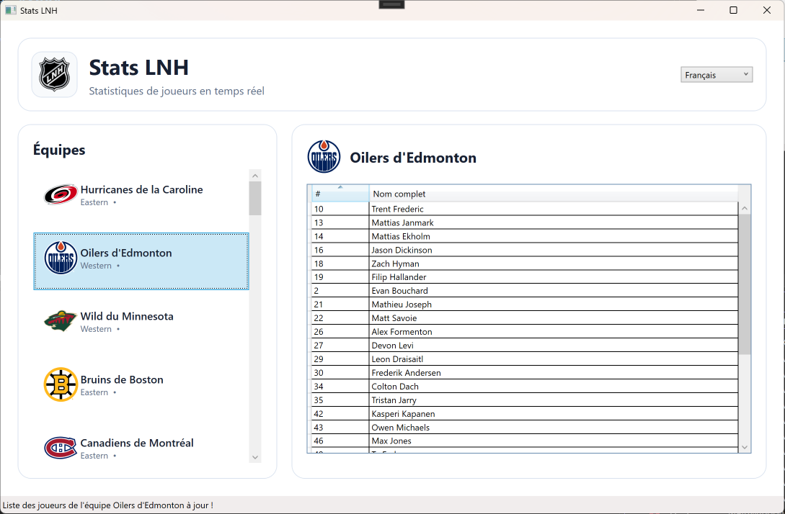
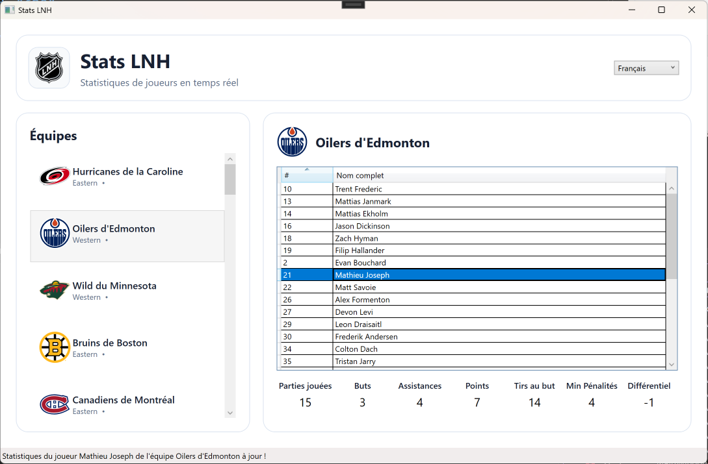
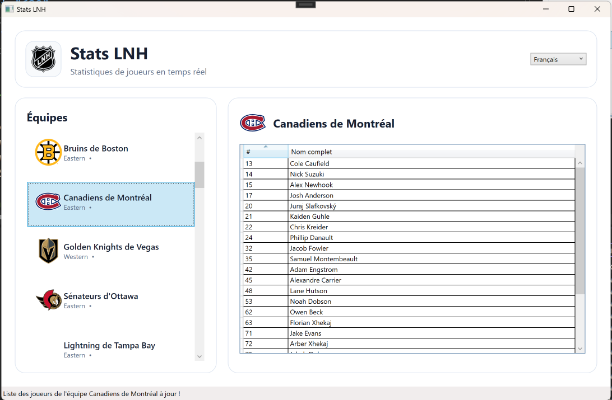

<p align="Center"></p>

<h4 align="Center">1SS - Sujets spéciaux</h4>

# 🏋🏻‍♂️ Projet 3 - NHLStats - 15 %

#### Lecture en temps réel des statistiques des joueurs.

## 1. Lecture des données des équipes

Un client vous demande de programer une application permettant de consulter la liste des équipes de la LNH, leurs joueurs respectifs ainsi que leurs statistiques individuelles, et ce, en temps réel.

Lors de l'ouverture de l'application, la liste des équipes sera téléchargée à partir de l'API de la NHL et affichée à l'écran. Lors de la sélection d'une équipe, la liste de ses joueurs sera également téléchargée et affichée à l'écran. Finalement, lors de la sélection d'un joueur, ses statistiques en cours seront à leur tour lues à partir de l'API et affichées à l'écran.

> Pour ce projet, aucune persistance de données métier n'est autorisée.

## 2. Visuels demandés
### Ouverture de l'application et sélection d'une équipe

### Sélection d'un joueur

### Sélection d'une autre équipe


## 3. Refactoriser un projet existant

Comme vous avez déjà programmé une application similaire, `NHLTeams`, vous devez repartir de la version actuelle du dépôt d'équipe original et effectuer le dépôt dans une nouvelle branche nommée `NHLStats`.

## 4. API de la NHL

### Pour obtenir la liste des équipes :

https://api-web.nhle.com/v1/standings/now

### Liste des joueurs d'une équipe précise :

https://api-web.nhle.com/v1/roster/MTL/current (où MTL est l'abréviation de l'équipe).

### Statistiques d'un joueur précis :

https://api-web.nhle.com/v1/player/8480018/landing (où 8480018 est l'identifiant du joueur). Pour obtenir les statistiques de l'année en cours, recherchez la clé `featuredStats.regularSeason.subSeason`.

## 5. Information complémentaire
### Async lors de l'ouverture
Vous constaterez qu'il est impossible de lancer une fonction `async` dans un constructeur.  Vous aurez besoin d'utiliser une méthode de cycle de vie.
#### Dans `MainWindow.xaml`:

Ajoutez `Loaded="Window_Loaded"` dans la section `Window`.

#### Dans `MainWindow.xaml.cs`
```csharp
private async void Window_Loaded(object sender, RoutedEventArgs e)
{
  if (DataContext is MainViewModel vm)
    await vm.InitializeAsync();
}
}
``` 

#### Dans `MainViewModel.cs`
```csharp
public async Task InitializeAsync()
{
  await LoadTeamsAsync();
}
``` 

### Utilisation d'un adaptateur `FromJson`
Il faut parfois adapter la lecture d'une structure Json non conventionnelle tel celle de la LNH.  Pour ce faire, nous utiliserons unr méthode `FromJson` qui prendra en paramètre un `token` json et le transformera en une équipe en mémoire.

Voici la classe [Team](./includes/Team.cs) que vous pouvez utiliser au besoin.

> Créez ensuite les classes `Player` et `Stat` en utilisant le même principe de design pattern.

### Déclencher une fonction async dans un setter
Un setter ne peut pas être async. Tu peux toutefois y lancer une méthode asynchrone avec `_ =`, sans attendre son résultat. Voici un exemple : 
```c++
  // Lance la méthode sans bloquer le setter.
  _ = LoadPlayersAsync(value);
```


## Critères de correction

| # | Critère | Points |
| --- | --------------- | ----- |
| 01 | La liste des équipes actuelles s'affiche à l'écran. | 2 |
| 02 | La première équipe est automatiquement sélectionnée. | 1 |
| 03 | La liste des joueurs d'une équipe s'affiche à l'écran. | 3 |
| 04 | La sélection d'un joueur affiche correctement ses statistiques. | 2 |
| 05 | Le visuel est conforme aux demandes de l'écran. | 1 |
| 06 | L'application fonctionne en français et en anglais. | 1 |
| 07 | Il est possible de sélectionner la langue dans l'application. | 1 |
| 08 | L'architecture de l'application est conforme aux enseignements (async, MVVM, services, etc.). | 3 |
| 10 | Application propre ne contenant que le code nécessaire. | 1 |

<hr><p align="Center"></p>