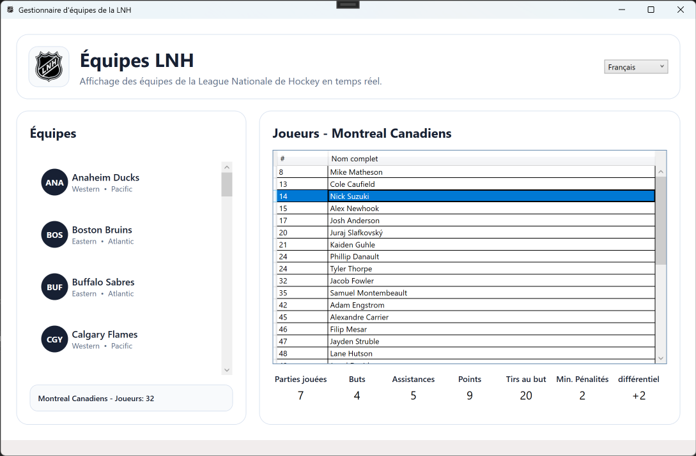

<h4 align="Center">1SS - Sujets spéciaux</h4>

# 🏋🏻‍♂️ Projet 3 - NHLStats - 15 %

#### Lecture en temps réel des statistiques des joueurs.

## 1. Lecture des données des équipes

Un client vous demande de programmer une application permettant de consulter la liste des équipes de la LNH, leurs joueurs respectifs ainsi que leurs statistiques individuelles, et ce, en temps réel.

Lors de l'ouverture de l'application, la liste des équipes sera téléchargée à partir de l'API de la NHL et affichée à l'écran. Lors de la sélection d'une équipe, la liste de ses joueurs sera également téléchargée et affichée à l'écran. Finalement, lors de la sélection d'un joueur, ses statistiques en cours seront à leur tour lues à partir de l'API et affichées à l'écran.

> Pour ce projet, aucune persistance de données métier n'est autorisée.

## 2. Visuel demandé

## 3. Refactoriser un projet existant

Comme vous avez déjà programmé une application similaire, `NHLTeams`, vous devez repartir de la version actuelle du dépôt d'équipe original et effectuer le dépôt dans une nouvelle branche nommée `NHLStats`.

## 4. API de la NHL

### Pour obtenir la liste des équipes :

https://api-web.nhle.com/v1/standings/now

### Liste des joueurs d'une équipe précise :

https://api-web.nhle.com/v1/roster/MTL/current (où MTL est l'abréviation de l'équipe).

### Statistiques d'un joueur précis :

https://api-web.nhle.com/v1/player/8480018/landing (où 8480018 est l'identifiant du joueur). Pour obtenir les statistiques de l'année en cours, recherchez la clé `featuredStats.regularSeason.subSeason`.

## Critères de correction

| # | Critère | Points |
| --- | --------------- | ----- |
| 01 | La liste des équipes actuelles s'affiche à l'écran. | 2 |
| 02 | La première équipe est automatiquement sélectionnée. | 0,5 |
| 03 | La liste des joueurs d'une équipe s'affiche à l'écran. | 3 |
| 04 | Le premier joueur de l'équipe est automatiquement sélectionné. | 0,5 |
| 05 | La sélection d'un joueur affiche correctement ses statistiques. | 2 |
| 06 | Le visuel est conforme aux demandes de l'écran. | 1 |
| 07 | L'application fonctionne en français et en anglais. | 1 |
| 08 | Il est possible de sélectionner la langue dans l'application. | 1 |
| 09 | L'architecture de l'application est conforme aux enseignements (async, MVVM, services, etc.). | 3 |
| 10 | Application propre ne contenant que le code nécessaire. | 1 |

