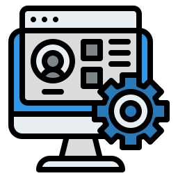

<h4 align="Center">1SS - Sujets spéciaux</h4>

# 🏋🏻‍♂️ Projet 4 - Banques 40% %

#### Injection de dépendances et tests (TDD).
L'objectif de ce projet est de mettre en pratique les éléments suivants:

- L'injection de dépendance
- Tests unitaires, incluant les Mock.

# 1. Présentation 

À partir du [projet de départ fournit](./Includes/GestionBanque.zip), vous devez accomplir une série de tâches concernant l'injection de dépendances et les tests unitaires. Les tests unitaires vous permettront d'identifier les bogues que vous devrez régler.

## Travail à accomplir

1. Dans le projet GestionBanque, vous devez utiliser l'injection de dépendances à l'aide de la librairie Autofac avec fichier de configuration json pour construire le MainViewModel dans le constructeur de MainView. Notez que deux des dépendances (`ClientSqliteDataService` et `CompteSqliteDataService`) nécessitent un paramètre. Vous devrez probablement consulter la documentation d'Autofac pour savoir comment bien écrire le fichier de configuration json.

 

2. Faites une suite de tests pour tester la classe Compte. Vous devez tester les méthodes suivantes :

- Retirer()
- Deposer()

3. Faites une suite de tests pour tester la classe Client. Vous devez tester les méthodes suivantes :

- Setter de Nom
- Setter de Prenom
- Setter de Courriel

4. Faites une suite de tests pour tester la classe CompteSqliteDataService. La classe de tests est déjà créée pour vous. Vous ne devez pas utiliser de Mock ici. Vous devez tester la méthode suivante : 

- Update()

5. Faites une suite de tests pour tester la classe ClientSqliteDataService. La classe de tests est déjà créée pour vous. Vous ne devez pas utiliser de Mock ici. Vous devez tester les méthodes suivantes : 

- GetAll()
- RecupererComptes()
- Update()

 

6. Faites une suite de tests pour tester la classe BanqueViewModel. Vous devez utiliser les Mocks (`librairie Moq`) pour simuler les dépendances. Vous devez tester les méthodes suivantes : 

- Le constructeur
- Le Setter de ClientSelectionne
- Modifier()
- Retirer()
- Deposer()

 

> NOTES IMPORTANTES:

Dans le projet principal, vous ne pouvez pas renommer aucune classes, méthodes ou variables.
Il n'y a pas nécessairement un bogue par méthode à tester, mais tous les bogues se retrouvent dans les méthodes à tester.
Je m'attends à au moins une méthode de tests par méthode à tester.
Je vous conseille de faire les tests dans l'ordre dans lequel ils vous sont présentés.
Il y a 8 bogues! Il ne sont pas évidents. Je suis chien, je sais!

 

# 2. La remise

La remise s'effectuera sur GitHub dans le repo de votre équipe `-ET` (pour épreuve terminale) dans la branche principale `Main`.

Un outil de comparaison des commites sera utilisé afin de vérifer si le travail à été balancé sur plusieurs commits et pour chacun des membres de l'équipe.

<!-- ## Critères de correction

| # | Critère | Points |
| --- | --------------- | ----- |
| 01 | La liste des équipes actuelles s'affiche à l'écran. | 2 |
| 02 | La première équipe est automatiquement sélectionnée. | 1 |
| 03 | La liste des joueurs d'une équipe s'affiche à l'écran. | 3 |
| 04 | La sélection d'un joueur affiche correctement ses statistiques. | 2 |
| 05 | Le visuel est conforme aux demandes de l'écran. | 1 |
| 06 | L'application fonctionne en français et en anglais. | 1 |
| 07 | Il est possible de sélectionner la langue dans l'application. | 1 |
| 08 | L'architecture de l'application est conforme aux enseignements (async, MVVM, services, etc.). | 3 |
| 10 | Application propre ne contenant que le code nécessaire. | 1 | -->

